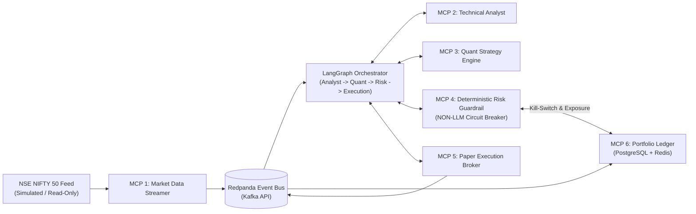

# AlphaTrader

**Autonomous Multi-Agent Algorithmic Trading & Deterministic Risk Orchestrator for NIFTY 50 (NSE) Paper Trading**

[](CHANGELOG.md)
[](pyproject.toml)
[](docs/adr/002-paper-trading-only.md)
[](pyproject.toml)
[](pyproject.toml)
[](LICENSE)

---

## 1. Project Vision & Why AlphaTrader Exists

Most multi-agent financial AI projects fail in serious engineering evaluations because they treat risk management as a prompt instruction inside a monolithic LLM loop. When an LLM is responsible for both proposing trades and checking its own risk limits, prompt drift, hallucinated arithmetic, or volatile market regimes can bypass capital controls.

**AlphaTrader** solves this by decoupling **cognitive multi-agent reasoning** from **deterministic risk enforcement and execution**:

- **Four Specialized Agents** (**Analyst**, **Quant**, **Risk**, **Execution**) orchestrated by a stateful **LangGraph** workflow analyze NIFTY 50 price action and synthesize structured trade proposals.
- **Six Isolated Model Context Protocol (MCP) Microservers** encapsulate every domain capability behind strict Pydantic v2 contracts.
- **A Deterministic, Non-LLM Risk Guardrail** (`src/mcp_servers/risk_guardrail`) enforces hard pre-trade and intraday invariants (such as a $2.0\%$ daily drawdown circuit breaker and $5.0\%$ single-stock concentration cap) in sub-millisecond pure Python—with unilateral authority to halt the entire trading floor.
- **End-to-End Auditability**: Every tick, agent transition, risk decision, and paper fill shares a propagated `correlation_id` across Redpanda (Kafka API), PostgreSQL, Redis, OpenTelemetry, Prometheus, and Grafana.

---

## 2. Safety Statement — Paper Trading Only

> [!IMPORTANT]
> **STRICT PAPER TRADING BOUNDARY ([ADR-002](docs/adr/002-paper-trading-only.md))**
>
> AlphaTrader is engineered **exclusively for simulated paper trading, quantitative strategy verification, and distributed systems research** on NSE NIFTY 50 market data.
>
> - **Nothing in this repository may ever call a real-money or live brokerage order endpoint.**
> - Startup configuration in [`src/common/config.py`](src/common/config.py) hard-locks `TRADING_MODE="PAPER"` and `LIVE_TRADING_ENABLED=False` using immutable Pydantic v2 validators. Any attempt to set `TRADING_MODE=LIVE` or `LIVE_TRADING_ENABLED=true` immediately aborts process startup with a fatal `SAFETY VIOLATION (ADR-002)` error.

---

## 3. Architecture Overview



For full component diagrams, sequence diagrams of the tick-to-fill lifecycle, and the deterministic risk-halt circuit breaker path, see **[`docs/architecture.md`](docs/architecture.md)**.

---

## 4. Technology Stack

| Layer | Technology | Role in AlphaTrader |
|---|---|---|
| **Language & Typing** | Python 3.11+, Pydantic v2, `pydantic-settings`, `mypy --strict` | Runtime validation, immutable settings, static type safety |
| **Agent Orchestration** | LangGraph | Stateful directed multi-agent orchestration (Analyst, Quant, Risk, Execution) |
| **Service Protocol** | Model Context Protocol (MCP) | Standardized tool/resource isolation across the 6 domain servers |
| **Event Bus** | Redpanda (Kafka API) | High-throughput asynchronous streaming (`market.ticks.nifty50`, `risk.halt`, `orders.filled.paper`) |
| **System of Record** | PostgreSQL 16 | ACID double-entry paper portfolio ledger & immutable risk audit log |
| **Low-Latency State** | Redis 7 | Intraday PnL, daily high-water mark (HWM), rate limiters, and floor-halt kill switch |
| **Observability** | OpenTelemetry, Prometheus, Grafana, Structured JSON Logging | Distributed `correlation_id` tracing, real-time metrics, and audit dashboards |
| **Deployment & CI** | Docker Compose, Kubernetes (Helm), GitHub Actions, Ruff, Pytest | Reproducible local stack, cloud-native orchestration, automated quality gates |

---

## 5. Quickstart (Reproducible from a Clean Clone)

### Prerequisites
- **Python 3.11+**
- **Git** and **GNU Make** (on Windows, install via `winget install ezwinports.make` or invoke the equivalent `python -m` commands listed below)

### Step-by-Step Setup & Verification

```bash
# 1. Clone the repository
git clone https://github.com/ayushkale06/AlphaTrader.git
cd AlphaTrader

# 2. (Optional) Create and activate a virtual environment
python -m venv .venv
# Linux/macOS: source .venv/bin/activate
# Windows PowerShell: .\.venv\Scripts\Activate.ps1

# 3. Copy the documented environment template (safe paper-trading defaults work out of the box)
cp .env.example .env

# 4. Install runtime and development dependencies in editable mode
make install
# Or directly: python -m pip install -e ".[dev]"

# 5. Run all quality gates (Ruff lint + format check, Mypy strict, Pytest with >=90% coverage)
make check

# 6. Run the CLI healthcheck entry point to verify version and config safety invariants
python -m src.common.healthcheck
```

### Expected Healthcheck Output

```json
{
  "status": "HEALTHY",
  "version": "0.1.0-alpha",
  "config_valid": true,
  "trading_mode": "PAPER",
  "live_trading_enabled": false,
  "service_name": "alphatrader-core",
  "app_env": "development",
  "market_timezone": "Asia/Kolkata",
  "nse_market_feed_mode": "SIMULATED",
  "risk_guardrail": {
    "max_daily_drawdown_pct": 2.0,
    "max_position_size_pct": 5.0,
    "max_open_positions": 10,
    "max_orders_per_minute": 30
  },
  "correlation_id": "<generated-uuid4>"
}
```

---

## 6. Component & Sprint Status Table

| Component / Package | Path | Planned Sprint | Current Status |
|---|---|---|---|
| **Typed Config & Safety Lock** | [`src/common/config.py`](src/common/config.py) | Sprint 1 | ✅ Implemented & Tested (100% coverage) |
| **Correlation-ID JSON Logger** | [`src/common/logging.py`](src/common/logging.py) | Sprint 1 | ✅ Implemented & Tested (97% coverage) |
| **CLI Healthcheck** | [`src/common/healthcheck.py`](src/common/healthcheck.py) | Sprint 1 | ✅ Implemented & Tested (100% coverage) |
| **Canonical Domain Schemas** | [`src/common/schemas/`](src/common/schemas/) | Sprint 2 | ⏳ Skeleton Ready |
| **Local Infra (PG, Redis, Redpanda)** | [`deploy/docker/`](deploy/docker/) | Sprint 3 | ⏳ Skeleton Ready |
| **MCP 1: Market Data Streamer** | [`src/mcp_servers/market_data_streamer/`](src/mcp_servers/market_data_streamer/) | Sprint 4 | ⏳ Skeleton & Spec Ready |
| **MCP 2: Technical Analyst** | [`src/mcp_servers/technical_analyst/`](src/mcp_servers/technical_analyst/) | Sprint 5 | ⏳ Skeleton & Spec Ready |
| **MCP 3: Quant Strategy Engine** | [`src/mcp_servers/quant_strategy_engine/`](src/mcp_servers/quant_strategy_engine/) | Sprint 6 | ⏳ Skeleton & Spec Ready |
| **MCP 4: Deterministic Risk Guardrail** | [`src/mcp_servers/risk_guardrail/`](src/mcp_servers/risk_guardrail/) | Sprint 7–8 | ⏳ Skeleton & Spec Ready |
| **MCP 5: Paper Execution Broker** | [`src/mcp_servers/paper_execution_broker/`](src/mcp_servers/paper_execution_broker/) | Sprint 9 | ⏳ Skeleton & Spec Ready |
| **MCP 6: Portfolio Ledger** | [`src/mcp_servers/portfolio_ledger/`](src/mcp_servers/portfolio_ledger/) | Sprint 10 | ⏳ Skeleton & Spec Ready |
| **Trading Agents (Analyst, Quant, Risk, Exec)** | [`src/agents/`](src/agents/) | Sprint 11 | ⏳ Skeleton Ready |
| **LangGraph Orchestrator** | [`src/orchestrator/`](src/orchestrator/) | Sprint 12 | ⏳ Skeleton Ready |
| **Observability (OTel, Prometheus, Grafana)** | [`src/observability/`](src/observability/) | Sprint 15–16 | ⏳ Skeleton Ready |
| **Kubernetes / Helm Chart** | [`deploy/k8s/`](deploy/k8s/) | Sprint 17–18 | ⏳ Skeleton Ready |

---

## 7. Documentation Index

- **[`ROADMAP.md`](ROADMAP.md)** — Full 24-sprint (5–6 day cadence) engineering plan with goals, deliverables, and definitions of done.
- **[`docs/architecture.md`](docs/architecture.md)** — System architecture, Mermaid component/sequence/risk-halt diagrams, and deterministic risk guardrail rationale.
- **[`docs/adr/001-multi-agent-mcp-architecture.md`](docs/adr/001-multi-agent-mcp-architecture.md)** — ADR-001: Why LangGraph + 6 isolated MCP microservices.
- **[`docs/adr/002-paper-trading-only.md`](docs/adr/002-paper-trading-only.md)** — ADR-002: Paper-trading-only safety boundary and 4-layer code enforcement.
- **[`DEV_LOG.md`](DEV_LOG.md)** — Engineering log of what was built, real bugs caught and fixed, and lessons learned per sprint.
- **[`CONTRIBUTING.md`](CONTRIBUTING.md)** — Conventional Commit standards, safety rules, and quality gate workflow.
- **[`CHANGELOG.md`](CHANGELOG.md)** — Release history in Keep a Changelog format.
