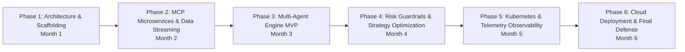

# AlphaTrader: 6-Month Phased Engineering Roadmap

**Project Duration:** 6 Months (24 Sprints of 5–6 Days Each)  
**Evaluation Frequency:** Professor GitHub Code Review every 5–6 Days  

---

## 🎯 Phase Overview

---

## 📅 Detailed Milestone Schedule

### Phase 1: Requirements, Architecture & Repository Blueprint (Month 1 / Sprints 1–4)
- [x] **Sprint 1 (Days 1–5):** Scaffolding repository structure, `README.md`, `ROADMAP.md`, `docs/architecture.md`, `ADR-001`.
- [ ] **Sprint 2 (Days 6–10):** OpenAPI specs for 6 MCP microservices, define Pydantic schemas for market ticks, order requests, and agent states.
- [ ] **Sprint 3 (Days 11–15):** Docker Compose local infrastructure setup (PostgreSQL, Redis, Redpanda Kafka broker).
- [ ] **Sprint 4 (Days 16–20):** GitHub Actions CI pipeline setup (Ruff/Flake8 linting, Pytest framework initialization).

### Phase 2: Microservice Protocol Layer & Data Ingestion (Month 2 / Sprints 5–8)
- [ ] **Sprint 5 (Days 21–25):** Implement **MCP Server 1: Market Data Streamer** (WebSocket ingestion for live market ticks).
- [ ] **Sprint 6 (Days 26–30):** Implement **MCP Server 2: Technical Analyst** (MACD, RSI, Bollinger Bands calculation engines).
- [ ] **Sprint 7 (Days 31–35):** Implement **MCP Server 5: Execution Broker API** (Paper-trading order matching engine).
- [ ] **Sprint 8 (Days 36–40):** Implement **MCP Server 6: Portfolio Ledger** (PostgreSQL schema & transactional audit history).

### Phase 3: Multi-Agent Orchestrator MVP (Month 3 / Sprints 9–12)
- [ ] **Sprint 9 (Days 41–45):** Build base LangGraph state machine connecting Market Data to Analyst Agent.
- [ ] **Sprint 10 (Days 46–50):** Implement Quant Strategy Agent with multi-factor weighting algorithms.
- [ ] **Sprint 11 (Days 51–55):** Build end-to-end execution pipeline from raw ticker feed to paper order placement.
- [ ] **Sprint 12 (Days 56–60):** Develop Next.js / React interactive live paper trading dashboard.

### Phase 4: Deterministic Risk Guardrail & Circuit Breakers (Month 4 / Sprints 13–16)
- [ ] **Sprint 13 (Days 61–65):** Implement **MCP Server 4: Deterministic Risk Guardrail** (Hard drawdown limits, position sizing rules).
- [ ] **Sprint 14 (Days 66–70):** Implement Emergency Floor Halt mechanism & real-time WebSocket alert feed.
- [ ] **Sprint 15 (Days 71–75):** Stress testing risk engine under high market volatility simulation.
- [ ] **Sprint 16 (Days 76–80):** Integration tests for agent override scenarios (Analyst recommends BUY, Risk overrides to REJECT).

### Phase 5: Kubernetes Orchestration & Telemetry (Month 5 / Sprints 17–20)
- [ ] **Sprint 17 (Days 81–85):** Write Kubernetes Deployment manifests & Helm charts for all 6 MCP microservices.
- [ ] **Sprint 18 (Days 86–90):** Integrate Prometheus metrics exporters across all Python services.
- [ ] **Sprint 19 (Days 91–95):** Build production Grafana dashboard visualizing PnL, Win Rate, Latency, and Risk Flags.
- [ ] **Sprint 20 (Days 96–100):** Load testing microservices using Locust (10,000 synthetic tick streams/sec).

### Phase 6: Cloud Deployment, Security Audit & Final Defense (Month 6 / Sprints 21–24)
- [ ] **Sprint 21 (Days 101–105):** Deploy entire stack to cloud infrastructure (Managed Kubernetes / Cloud VM).
- [ ] **Sprint 22 (Days 106–110):** Conduct security audit (Dependency scanning, credential redaction, RBAC enforcement).
- [ ] **Sprint 23 (Days 111–115):** Finalize end-to-end user documentation, architectural video walkthrough, and demo scripts.
- [ ] **Sprint 24 (Days 116–120):** Prepare technical presentation deck & practice interview defense Q&A.
