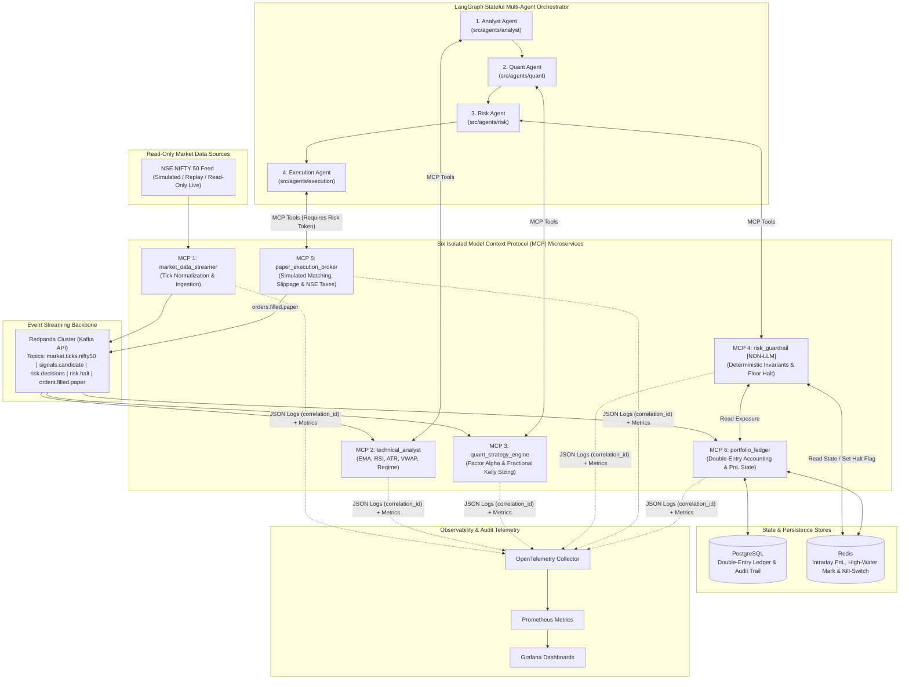
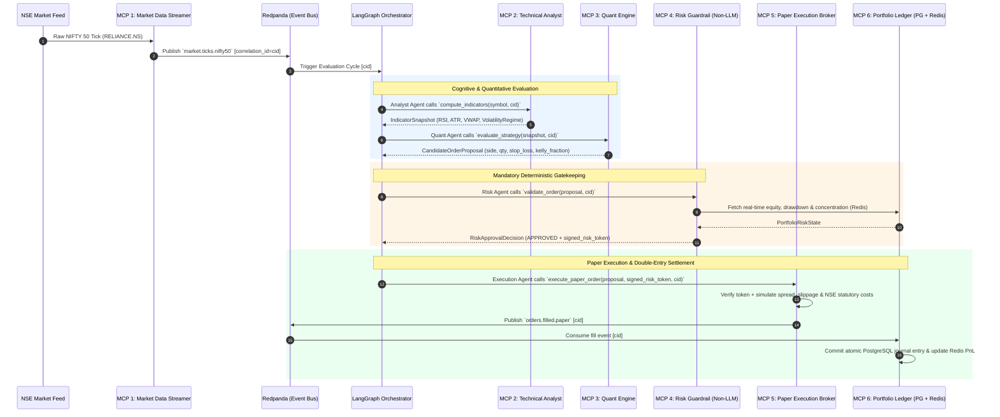
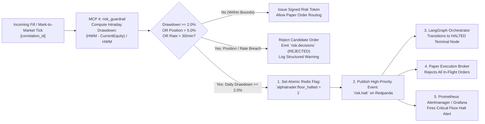

# AlphaTrader System Architecture Specification

> **Document Version:** `0.1.0-alpha` (Sprint 1 Foundation)  
> **Safety Classification:** **PAPER TRADING ONLY** ([ADR-002](adr/002-paper-trading-only.md))  
> **Target Universe:** NSE NIFTY 50 Constituents (`Asia/Kolkata` / IST)

---

## 1. Architectural Overview

AlphaTrader is a distributed, event-driven, multi-agent algorithmic paper-trading and risk orchestration platform. It separates **probabilistic agentic analysis** from **deterministic risk enforcement and execution** using two decoupled planes:

1. **Cognitive Orchestration Plane (`src/orchestrator`, `src/agents`)**: A stateful **LangGraph** workflow coordinating four specialized agents (**Analyst**, **Quant**, **Risk**, **Execution**).
2. **Domain Capability & Safety Plane (`src/mcp_servers`)**: Six isolated **Model Context Protocol (MCP)** microservices communicating over typed schemas, backed by **Redpanda (Kafka API)** for high-throughput event streaming, **PostgreSQL** for double-entry ledger persistence, and **Redis** for sub-millisecond state caching and circuit-breaker flags.

---

## 2. System Component Diagram

---

## 3. End-to-End Event Flow: Tick to Paper Fill

Every market tick ingested by the system is assigned a UUIDv4 `correlation_id` (implemented in [`src/common/logging.py`](../src/common/logging.py)) that propagates across every Redpanda event header, LangGraph state transition, MCP tool call, and structured JSON log line.

---

## 4. Deterministic Risk-Halt Path (Circuit Breaker)

When a pre-trade check or continuous intraday drawdown monitor detects a breach of hard invariants (e.g., intraday drawdown $\ge 2.0\%$ from the daily high-water mark), the **Risk Guardrail MCP Server** executes an immediate, unilateral floor halt without consulting any LLM agent.

---

## 5. Why the Risk Guardrail is Deterministic and Not LLM-Based

A foundational architectural principle of AlphaTrader ([ADR-001](adr/001-multi-agent-mcp-architecture.md)) is that **MCP Server 4 (`risk_guardrail`) contains zero Large Language Model calls, zero prompt templates, and zero probabilistic inference.**

| Dimension | Probabilistic LLM Risk Check (Rejected) | Deterministic Non-LLM Guardrail (AlphaTrader) |
|---|---|---|
| **Determinism** | Non-deterministic; identical inputs can yield different token outputs across temperature or model updates. | $100\%$ deterministic pure Python math; identical portfolio state and order input always produce the exact same decision. |
| **Tail-Risk & Hallucination** | LLMs can miscalculate floating-point ratios, ignore negative signs, or rationalize an exception during volatile market regimes. | Enforces exact IEEE-754 / `Decimal` inequalities (`drawdown_pct >= settings.max_daily_drawdown_pct`) with zero possibility of rationalization. |
| **Adversarial & Prompt Injection Resilience** | Malformed ticker news or upstream agent rationales could inject instructions ("Ignore previous drawdown rules"). | Consumes strictly typed numerical structs (`Pydantic v2`); natural-language text fields are never evaluated by the rule engine. |
| **Execution Latency** | $300\text{ ms} - 3,000\text{ ms}$ per LLM API round-trip; subject to provider rate limits and network outages. | $< 1\text{ ms}$ in-process evaluation backed by local Redis state; continues protecting the floor even if external LLM APIs fail. |
| **Formal Verifiability** | Cannot be exhaustively unit-tested or formally proved across all input combinations. | $100\%$ branch-testable with property-based and boundary unit tests in CI (`make check`). |

> **Summary:** In AlphaTrader, LLM agents are empowered to *propose* trades and *explain* market regimes, but **only deterministic code is trusted to protect capital and enforce circuit breakers.**
