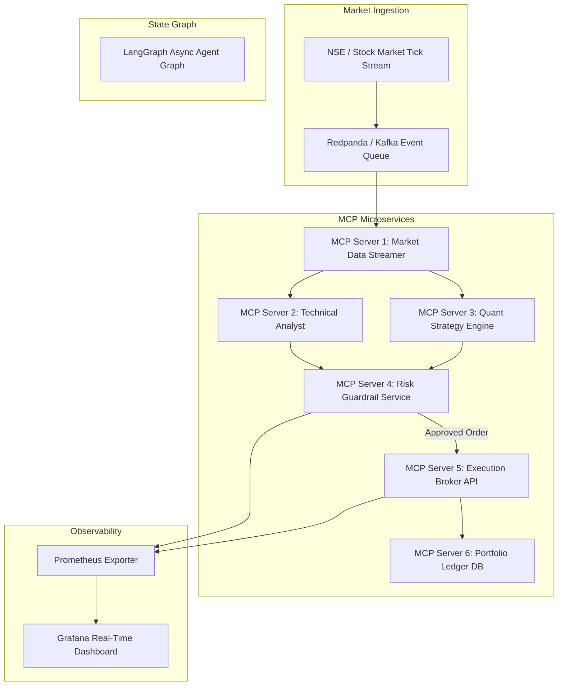

# AlphaTrader System Architecture Specification

## 1. Overview
AlphaTrader is an autonomous multi-agent financial engine designed to run paper-trading strategies over live market data feeds while enforcing strict, non-LLM deterministic risk guardrails.

## 2. Decoupled Microservice Architecture (6 MCP Servers)

### MCP Server 1: Market Data Streamer
* **Responsibilities:** Subscribes to live WebSocket tick streams, normalizes incoming market data frames, and broadcasts normalized JSON ticks.
* **Protocols:** WebSockets, Asyncio, gRPC.

### MCP Server 2: Technical Analyst Engine
* **Responsibilities:** Calculates exponential moving averages (EMA 20/50/200), MACD, RSI (14), Bollinger Bands, and volume weighted average price (VWAP) on dynamic tick windows.
* **Protocols:** Python Pandas/Numpy, FAST-API, MCP Tool endpoints.

### MCP Server 3: Quant Strategy Engine
* **Responsibilities:** Evaluates multi-factor signals (Trend Following, Mean Reversion, Momentum) to produce weighted trading proposals (Action, Ticker, Quantity, Target Price, Stop Loss).
* **Protocols:** LangGraph State Machine, Pydantic v2 validation schemas.

### MCP Server 4: Deterministic Risk Guardrail Service
* **Responsibilities:** Evaluates proposed orders against strict mathematical risk rules **without using LLM judgment**. 
* **Rules Enforced:**
  1. Maximum daily account drawdown threshold (e.g. 2.0%).
  2. Single position concentration risk limit (max 5.0% of portfolio).
  3. Max order slippage allowance (max 0.25%).
  4. Real-time volatility threshold check.
* **Outcome:** `APPROVED` or `REJECTED` (with explicit failure rationale).

### MCP Server 5: Execution Broker API
* **Responsibilities:** Simulates real-world market execution matching orders against current market order book bid/ask prices with simulated latency and slippage models.
* **Protocols:** REST / WebSockets.

### MCP Server 6: Portfolio Ledger & Audit Database
* **Responsibilities:** Maintains an immutable transaction journal of all order submissions, fills, risk rejections, and portfolio valuations in PostgreSQL with Redis caching.
* **Protocols:** PostgreSQL, asyncpg, Redis.

## 3. Telemetry & Observability
All microservices publish Prometheus counters, histograms, and gauges:
- `mcp_market_data_ticks_total`: Total market ticks processed.
- `mcp_agent_decision_latency_seconds`: Latency per agent cycle.
- `mcp_risk_rejections_total`: Counter for orders blocked by Risk Guardrail.
- `mcp_portfolio_pnl_rupees`: Current total paper portfolio value.
