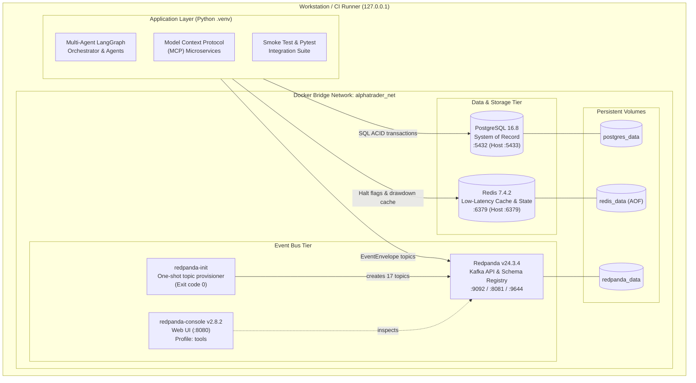

# AlphaTrader Local Infrastructure Guide

This document details the local production-grade infrastructure stack for AlphaTrader, including service topology, database schemas, topic provisioning, disaster recovery, and operational troubleshooting.

---

## 1. Architecture Topology

The infrastructure runs inside an isolated Docker bridge network (`alphatrader_net`) with all host ports bound strictly to `127.0.0.1` for local workstation security.



---

## 2. Service Inventory

| Service | Image | Host Port | Internal Port | Volume | Healthcheck |
| :--- | :--- | :--- | :--- | :--- | :--- |
| **PostgreSQL 16** | `postgres:16.8-alpine` | `127.0.0.1:5433` (or `POSTGRES_PORT`) | `5432` | `postgres_data` | `pg_isready -U alphatrader -d alphatrader_ledger` |
| **Redis 7** | `redis:7.4.2-alpine` | `127.0.0.1:6379` | `6379` | `redis_data` | `redis-cli ping` |
| **Redpanda** | `docker.redpanda.com/redpandadata/redpanda:v24.3.4` | `127.0.0.1:9092`<br/>`127.0.0.1:9644`<br/>`127.0.0.1:8081` | `9092` (Kafka)<br/>`9644` (Admin)<br/>`8081` (Schema Reg) | `redpanda_data` | `rpk cluster health` (grepping for `Healthy: true`) |
| **redpanda-init** | `docker.redpanda.com/redpandadata/redpanda:v24.3.4` | None | N/A | None | Idempotent one-shot provisioning container |
| **redpanda-console** | `docker.redpanda.com/redpandadata/console:v2.8.2` | `127.0.0.1:8080` (profile `tools`) | `8080` | None | Web UI for inspecting topics, partitions, and consumer groups |

---

## 3. Database Schema & Contract Alignment

The database schema (`deploy/docker/init.sql`) mirrors the typed models in `src/common/schemas/`:

| Database Table | Pydantic Schema Model | Primary Invariants & Constraints |
| :--- | :--- | :--- |
| `orders` | `Order` (`src/common/schemas/orders.py`) | - `idempotency_key` is `UNIQUE NOT NULL` (double-execution impossible)<br/>- `CHECK (quantity > 0)` and `CHECK (stop_loss_price > 0)`<br/>- `status` checked against `OrderStatus` state machine |
| `fills` | `Fill` (`src/common/schemas/orders.py`) | - `FOREIGN KEY (order_id) REFERENCES orders(order_id)`<br/>- `CHECK (total_fees = stt_tax + exchange_fees + gst_tax + stamp_duty)` |
| `positions` | `Position` (`src/common/schemas/portfolio.py`) | - `CHECK (quantity >= 0)` and `CHECK (average_buy_price >= 0)` |
| `portfolio_snapshots` | `PortfolioSnapshot` (`src/common/schemas/portfolio.py`) | - `CHECK (cash >= 0)`, `CHECK (equity >= 0)`<br/>- `CHECK (max_drawdown_pct >= 0 AND max_drawdown_pct <= 1)` |
| `risk_audit_log` | `RiskDecision` (`src/common/schemas/risk.py`) | - **APPEND-ONLY TRIGGER**: `trg_protect_risk_audit_log` raises exception on any `UPDATE` or `DELETE`<br/>- `inputs_snapshot` stored as structured `JSONB` |
| `schema_migrations` | Baseline tracking | - Records applied migrations; seeded with `001_initial_schema` |

---

## 4. Kafka Topics & Contract Registry

Topics are strictly governed by `TOPIC_REGISTRY` in `src/common/contracts.py`. No topics are manually defined in Docker Compose:

| Topic Name | Message Key | Partitions | Retention | Dead Letter Queue (.dlq) |
| :--- | :--- | :--- | :--- | :--- |
| `market.ticks` | `symbol` | 3 | 24 hours | `market.ticks.dlq` (3 partitions, 168h) |
| `market.candles` | `symbol` | 3 | 72 hours | `market.candles.dlq` (3 partitions, 168h) |
| `signals.technical` | `symbol` | 3 | 48 hours | `signals.technical.dlq` (3 partitions, 168h) |
| `signals.quant` | `symbol` | 3 | 48 hours | `signals.quant.dlq` (3 partitions, 168h) |
| `risk.decisions` | `order_request_id` | 3 | 168 hours | `risk.decisions.dlq` (3 partitions, 168h) |
| `orders.requests` | `symbol` | 3 | 168 hours | `orders.requests.dlq` (3 partitions, 168h) |
| `orders.fills` | `symbol` | 3 | 720 hours | `orders.fills.dlq` (3 partitions, 168h) |
| `portfolio.updates` | `snapshot_id` | 1 | 720 hours | `portfolio.updates.dlq` (1 partition, 168h) |
| `system.events` | `source` | 1 | 168 hours | None (system events record their own errors) |

---

## 5. Operations & Developer Workflow

### Quick Commands

```bash
# Start all services in the background
make up           # Linux / macOS
.\make.ps1 up     # Windows PowerShell

# Check container health and status
make ps
.\make.ps1 ps

# Run end-to-end smoke test
make smoke
.\make.ps1 smoke

# Run integration tests against local infrastructure
make test-integration
.\make.ps1 test-integration

# Open interactive PostgreSQL shell
make psql
.\make.ps1 psql

# Open interactive Redis CLI
make redis-cli
.\make.ps1 redis-cli

# Start Redpanda Console Web UI (optional)
docker compose --env-file .env -f deploy/docker/docker-compose.yml --profile tools up -d redpanda-console
# Open in browser: http://127.0.0.1:8080
```

### Disaster Recovery

- **Normal Shutdown (Preserve State)**:
  ```bash
  make down
  .\make.ps1 down
  ```
  Stops containers while preserving data volumes (`postgres_data`, `redis_data`, `redpanda_data`).
- **Hard Reset (Destroy & Clean Slate)**:
  ```bash
  make reset
  .\make.ps1 reset
  ```
  Tears down all containers and completely removes named volumes. On next `make up`, Postgres re-executes `init.sql`, and Redpanda re-creates all topics from scratch.

---

## 6. Troubleshooting Local Infrastructure

### 1. Port 5432 Host Conflict (PostgreSQL)
- **Symptom**: `bind: address already in use` when starting Postgres.
- **Cause**: Windows or Linux workstations often run a native system Postgres instance on port 5432.
- **Fix**: The default `.env.example` sets `POSTGRES_PORT=5433`. Docker maps `127.0.0.1:5433 -> 5432`, allowing both to coexist. Verify `src/common/config.py` connects to port 5433 via `settings.postgres_port`.

### 2. Docker Desktop Daemon Connection Failure
- **Symptom**: `failed to connect to the docker API at npipe:////./pipe/dockerDesktopLinuxEngine`.
- **Cause**: Docker Desktop is not running.
- **Fix**: Launch Docker Desktop and wait for the Linux engine to report healthy. Verify via `docker version`.

### 3. Redpanda Memory Limit on Laptops
- **Symptom**: Container crashes or hangs on start with out-of-memory errors.
- **Cause**: Redpanda defaults to Seastar memory reservation.
- **Fix**: `deploy/docker/docker-compose.yml` explicitly sets `--smp 1 --memory 1G --reserve-memory 0M --overprovisioned` and limits container memory to 1.5G, ensuring stable execution even on constrained hardware.
