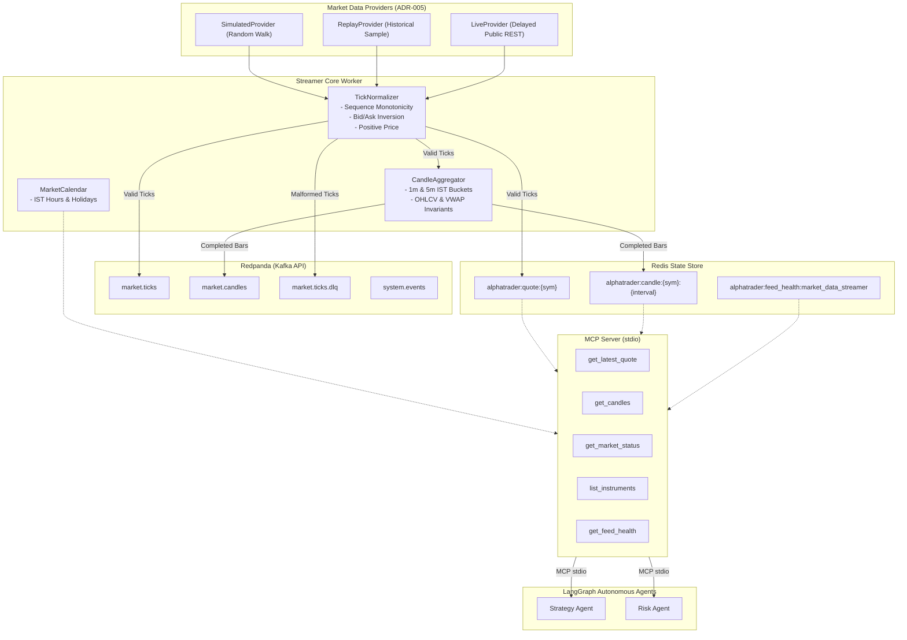

# Market Data Streamer MCP Server

- **Package:** `src.mcp_servers.market_data_streamer`
- **Protocol:** Model Context Protocol (MCP) over `stdio` transport
- **Sprint:** Sprint 4 (Days 16–20)
- **Status:** Production-Ready (v0.4.0-alpha)

---

## 1. Architectural Overview

The Market Data Streamer is AlphaTrader's ingestion engine and its first Model Context Protocol (MCP) server. It ingests ticks for the 50 NSE NIFTY constituents, normalizes quotes to the canonical contract registry, enforces strict data provenance, aggregates 1m and 5m candlestick bars, publishes events to Redpanda topics, maintains hot cache in Redis, and exposes 5 read-only tools to LLM agents.



---

## 2. Data Provenance & Timestamp Semantics

To uphold rigorous academic integrity, **no synthetic or delayed data may ever be presented as real-time**. Every tick and candle published carries a `DataProvenance` model:

- `provider`: Identifying string of the data generator (e.g. `simulated_feed`, `replay_feed`, `yahoo_finance_delayed`).
- `feed_mode`: Enum (`SIMULATED`, `REPLAY`, `LIVE`).
- `is_delayed`: Boolean flag.
- `delay_seconds`: Dissemination delay in seconds (e.g. 900s for public delayed data; 0 for simulated/replay).
- `ingested_at`: UTC timestamp of when AlphaTrader received the data packet.

### Timestamps
- `Tick.timestamp` / `Candle.open_time`: The exchange **market event time**. Historical replay preserves the recorded event times.
- `DataProvenance.ingested_at`: The local **receive timestamp**.

---

## 3. MCP Tool Catalogue

All tools are read-only and return structured JSON responses.

### 1. `get_latest_quote`
Retrieves the most recent quote tick for a symbol from the hot Redis cache.
- **Arguments**: `symbol: str` (e.g., `"RELIANCE"`, `"RELIANCE.NS"`)
- **Sample Output**:
```json
{
  "symbol": "RELIANCE.NS",
  "timestamp": "2026-10-13T03:45:00Z",
  "last_price": "2950.00",
  "volume": "500",
  "bid_price": "2949.75",
  "ask_price": "2950.25",
  "sequence_number": 1,
  "provenance": {
    "provider": "simulated_feed",
    "feed_mode": "SIMULATED",
    "is_delayed": false,
    "delay_seconds": 0,
    "ingested_at": "2026-10-13T09:40:00.123456Z"
  }
}
```

### 2. `get_candles`
Retrieves historical or recent OHLCV candlestick bars for a symbol and interval.
- **Arguments**: `symbol: str`, `interval: str` (`"1m"`, `"5m"`), `limit: int` (default `50`, max `500`)
- **Sample Output**:
```json
[
  {
    "symbol": "TCS.NS",
    "interval": "1m",
    "open_time": "2026-10-13T03:45:00Z",
    "close_time": "2026-10-13T03:46:00Z",
    "open": "4100.00",
    "high": "4102.50",
    "low": "4099.50",
    "close": "4102.50",
    "volume": "750",
    "vwap": "4101.20",
    "trade_count": 4,
    "provenance": {
      "provider": "simulated_feed",
      "feed_mode": "SIMULATED",
      "is_delayed": false,
      "delay_seconds": 0,
      "ingested_at": "2026-10-13T09:40:00.123456Z"
    }
  }
]
```

### 3. `get_market_status`
Evaluates the current NSE exchange operating status, session phase, and holiday notes in IST.
- **Arguments**: None
- **Sample Output**:
```json
{
  "exchange": "NSE",
  "timezone": "Asia/Kolkata",
  "as_of": "2026-10-13T09:45:00Z",
  "session": "OPEN",
  "is_open": true,
  "reason": "Continuous regular trading session (09:15 - 15:30 IST)"
}
```

### 4. `list_instruments`
Returns the active NIFTY 50 universe constituents with metadata and rebalance notice.
- **Arguments**: None
- **Sample Output**:
```json
{
  "index_name": "NIFTY 50",
  "as_of_date": "2026-10-01",
  "rebalance_warning": "Constituents reflect NSE semi-annual reconstitution. Verify active symbols on index adjustment dates.",
  "symbols_count": 50,
  "symbols": ["ADANIENT.NS", "ADANIPORTS.NS", "APOLLOHOSP.NS", "...", "WIPRO.NS"]
}
```

### 5. `get_feed_health`
Returns ingestion pipeline telemetry, tick counts, candle counts, and DLQ rejections.
- **Arguments**: None
- **Sample Output**:
```json
{
  "status": "RUNNING",
  "symbols_count": 50,
  "ticks_ingested": 1420,
  "candles_emitted": 84,
  "dlq_count": 0,
  "last_heartbeat": "2026-10-13T09:45:10Z"
}
```

---

## 4. Runbook & Developer Operations

### Prerequisites
Ensure the local infrastructure stack is up and healthy:
```powershell
.\make.ps1 up
.\make.ps1 smoke
```

### Starting the Market Data Streamer
To run the background ingestion worker:
```powershell
.\make.ps1 stream
```
By default, this uses `SIMULATED` feed mode. To switch feed modes, set in `.env`:
```bash
NSE_MARKET_FEED_MODE=SIMULATED  # or REPLAY or LIVE
```

### Running the MCP Server
To start the MCP server on stdio for client connection:
```powershell
.\make.ps1 mcp-market
```
Or directly via Python:
```bash
python -m src.mcp_servers.market_data_streamer.server
```
