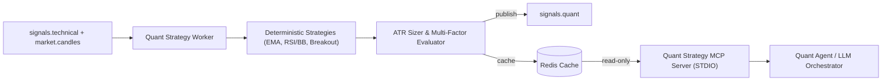

# Quant Strategy Engine MCP Server (MCP Server 3)

## Overview

The **Quant Strategy Engine MCP Server** exposes read-only query and analytical proposal interfaces for quantitative strategy decisions, target portfolio allocations, and backtest report verifications.

It operates under strict **Indian Equity Cash Delivery** constraints:
- Direction `SHORT` is prohibited (long-only cash delivery).
- Position exits are represented as `Direction.FLAT` with `target_weight = Decimal("0")`.
- Expected edge (`expected_net_edge_bps_per_trade`) is gated: it MUST remain `None` unless backed by a cryptographically verified out-of-sample backtest report registered in `docs/backtests/index.json`.
- Proposals are analytical only; downstream pre-trade risk guardrails (Sprint 7) dispose. No broker execution or order placement occurs here.

---

## 1. FastMCP Tools Reference

The server exposes 8 pure, side-effect-free tools:

### Read-Only Tools (Core)
1. **`list_strategies()`**  
   Catalog all registered deterministic quantitative strategies, versions, and configuration SHA-256 hashes.
   - *Returns:* `dict` containing list of registered strategies (`strategy_name`, `strategy_version`, `config_hash`, `config`).

2. **`get_strategy_signal(symbol: str, strategy_name: str, interval: str)`**  
   Retrieve the latest `QuantSignal` proposal for a specific symbol, strategy, and interval.
   - *Returns:* Cached signal details (`direction`, `target_weight`, `expected_net_edge_bps_per_trade`, `edge_basis`, `backtest_report_id`).

3. **`get_target_portfolio()`**  
   Retrieve aggregate recommended portfolio asset target weights across all evaluated symbols.
   - *Returns:* `target_weights` mapping and `cash_weight`.

4. **`get_backtest_report(report_id: str)`**  
   Look up a backtest report by its SHA-256 hash in `docs/backtests/index.json`.
   - *Returns:* Metadata, date range, data source, and validation status (distinguishing true `OUT_OF_SAMPLE` from full-sample demo reports).

5. **`explain_strategy_signal(symbol: str, strategy_name: str, interval: str)`**  
   Inspect the exact deterministic logic, indicator inputs, and rule triggers that produced a strategy recommendation.
   - *Returns:* Breakdown of active indicators, strategy version, and configuration hash.

6. **`get_engine_health()`**  
   Query operational health, message counts, and uptime heartbeat recorded in Redis.
   - *Returns:* `status`, `processed_count`, and timestamp.

### Analytical Proposal Tools
7. **`evaluate_alpha_factors(symbol: str, interval: str)`**  
   Deterministically score and combine multi-factor models (Trend, Mean Reversion, Breakout) with explicit conflict resolution explanation.
   - *Returns:* `composite_score`, `factor_scores`, `contributions`, and `conflict_resolution`.

8. **`propose_sized_order(symbol: str, strategy_name: str, interval: str)`**  
   Calculate proposed ATR stop-loss / take-profit brackets and fractional-Kelly volatility-targeted sizing without placing orders.
   - *Returns:* `proposed_target_weight`, `stop_loss_price`, `take_profit_price`, `risk_per_share`, and `method`.

---

## 2. Mathematical Formulations & Decision Rules

### 2.1 Multi-Factor Composite Scoring
Each factor $i \in \{\text{trend}, \text{reversion}, \text{breakout}\}$ produces a signed score $S_i \in [-1.0, +1.0]$:
- $S_i > 0$: Bullish impulse
- $S_i < 0$: Bearish impulse
- $S_i = 0$: Neutral or warming up

$$\text{Composite} = (w_{\text{trend}} \times S_{\text{trend}}) + (w_{\text{reversion}} \times S_{\text{reversion}}) + (w_{\text{breakout}} \times S_{\text{breakout}})$$

Where default weights are $w_{\text{trend}} = 0.40, w_{\text{reversion}} = 0.30, w_{\text{breakout}} = 0.30$.
- **Decision Rule:**
  - If $\text{Composite} \ge +0.25$: Direction = `LONG`
  - Else: Direction = `FLAT` (Cash deliverySegment: Shorting prohibited)

### 2.2 ATR Bracket Calculation
For a `LONG` proposal at bar close $P_t$ with $\text{ATR}_{14}$:
$$\text{Risk Per Share} = \text{ATR}_{14} \times \text{Multiplier}_{\text{SL}} \quad (\text{default } 2.0)$$
$$\text{Stop Loss} = \max(0.05, P_t - \text{Risk Per Share})$$
$$\text{Take Profit} = P_t + (\text{ATR}_{14} \times \text{Multiplier}_{\text{TP}}) \quad (\text{default } 3.0)$$

All bracket prices are quantized to tick size $\text{INR } 0.05$.

### 2.3 Fractional-Kelly Sizing
For win rate $p$, loss rate $q = 1 - p$, and payoff ratio $b = \frac{\text{Average Win}}{\text{Average Loss}}$:
$$f^* = \frac{p \times b - q}{b}$$
$$\text{Target Weight} = \min\left(f^* \times \text{fraction}, \text{Max Position Weight}\right)$$
Where default Kelly fraction is $0.25$ and maximum position weight is $0.20$ ($20\%$).
If $f^* \le 0$, sizing falls back to the configured baseline allocation capped at max position weight.
