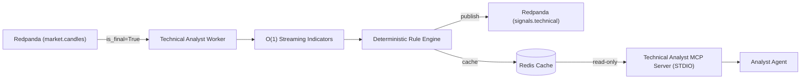

# Technical Analyst MCP Server (MCP Server 2)

## Overview

The **Technical Analyst MCP Server** provides streaming multi-timeframe technical indicator calculation, deterministic explainable signal generation, and read-only MCP tool interfaces for the **Analyst Agent** and orchestrator.

It operates strictly in **PAPER trading** mode and performs no position sizing, risk evaluation, or order placement.



---

## 1. Mathematical Formulas & Indicators

All streaming indicators run in $O(1)$ operations per new bar after warmup:

| Indicator | Complexity | Mathematical Definition | Warmup Period |
| :--- | :--- | :--- | :--- |
| **SMA** | $O(1)$ | $\frac{1}{N} \sum_{i=0}^{N-1} P_{t-i}$ (rolling sum buffer) | $N$ bars |
| **EMA** | $O(1)$ | $\text{EMA}_t = \alpha P_t + (1-\alpha) \text{EMA}_{t-1}, \alpha = \frac{2}{N+1}$ | $N$ bars |
| **RSI** | $O(1)$ | $100 - \frac{100}{1 + \text{RS}}$, Wilder's smoothed gains and losses | 14 bars |
| **MACD** | $O(1)$ | $\text{MACD} = \text{EMA}_{12} - \text{EMA}_{26}$, Signal = $\text{EMA}_9(\text{MACD})$, Hist = MACD - Signal | $26 + 9 - 1$ bars |
| **Bollinger Bands** | $O(1)$ | Middle = $\text{SMA}_{20}$, $\text{Std} = \sqrt{\frac{\sum P^2}{N} - \mu^2}$, Upper/Lower = Middle $\pm 2\sigma$ | 20 bars |
| **ATR** | $O(1)$ | $\text{TR} = \max(H-L, \|H-C_{prev}\|, \|L-C_{prev}\|)$, Wilder's smoothing | 14 bars |
| **Rolling VWAP** | $O(1)$ | $\frac{\sum (\text{Typical Price} \times \text{Volume})}{\sum \text{Volume}}$, session reset | Session open |
| **ADX** | $O(1)$ | Wilder smoothed DX with directional indices (+DI, -DI) | $2N - 1$ (27 bars) |
| **Stochastic** | $O(1)$ | $\%K = 100 \times \frac{C - L_{14}}{H_{14} - L_{14}}$, smoothed by 3-period SMA | 14 bars |

---

## 2. Signal Engine & Confidence Definition

Signals are deterministic and evaluated against `config/technical_rules.json` (versioned `1.0.0`).

> [!IMPORTANT]
> **Confidence Score Definition**:
> In AlphaTrader, confidence is strictly a **rule-agreement fraction** in $[0, 1]$:
> $$\text{confidence} = \frac{\text{number of rules agreeing with chosen direction}}{\text{total number of triggered directional rules}}$$
> It is **NOT** a calibrated probability of profit or expected return.

### Market Regime Classification
- `TRENDING_UP`: ADX $\ge 25.0$ and Close $\ge \text{EMA}_{50}$
- `TRENDING_DOWN`: ADX $\ge 25.0$ and Close $< \text{EMA}_{50}$
- `HIGH_VOL_CHOP`: ADX $< 25.0$ and Bollinger Bandwidth $> 0.05$
- `MEAN_REVERTING`: ADX $< 25.0$ and Bollinger Bandwidth $\le 0.05$

---

## 3. FastMCP Tools Reference

The server exposes 5 pure, side-effect-free read-only tools:

### `get_indicators`
- **Arguments**: `symbol: str`, `interval: str = "5m"`
- **Response**: Snapshot of computed ready indicator values.

### `get_signal`
- **Arguments**: `symbol: str`, `interval: str = "5m"`
- **Response**: Emitted `TechnicalSignal` model payload.

### `explain_signal`
- **Arguments**: `symbol: str`, `interval: str = "5m"`
- **Response**: Detailed audit breakdown of fired rules, justification, and confidence explanation.

### `list_supported_indicators`
- **Arguments**: None
- **Response**: Catalog of supported indicators, parameters, and algorithms.

### `get_analyzer_health`
- **Arguments**: None
- **Response**: Operational worker heartbeat and candle throughput.

---

## 4. Runbook & Commands

### Running Worker and MCP Server
```powershell
# Run Technical Analyst streaming worker
.\make.ps1 analyst

# Run FastMCP server over STDIO
.\make.ps1 mcp-analyst

# Run coverage gate (>= 90%)
.\make.ps1 test-analyst-coverage
```
